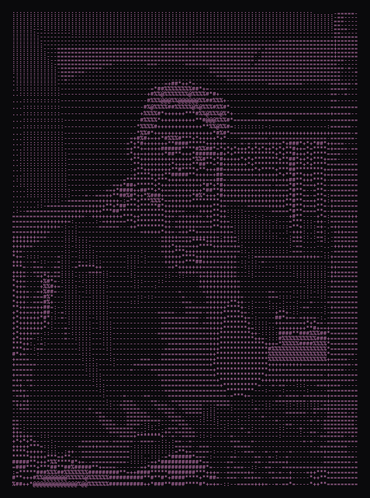

# Laith Abu-Saleem

**Amman, Jordan**

A researcher exploring the intersection of technology, neuroscience, and human behaviour, aiming to develop biomedical systems that enhance cognitive and physical capabilities by integrating psychology, neuroscience, and engineering. My work combines technical precision with human-centred design to advance medical technology and deepen understanding of the mind-body connection.

[Portfolio](https://laith-abu-saleem-portfolio.vercel.app)
·
[LinkedIn](https://www.linkedin.com/in/laith-abusaleem-1156b8353)
·
[Email](mailto:laithabusaleem0@gmail.com)
·
[+962 787 790 364](tel:+962787790364)

---

### Education

- **Islamic Educational College (IEC), Amman, Jordan** · Senior student, Class of 2026  
  Advanced coursework: Biology, Mathematics, Chemistry, Computer Science. Focus areas: Biomedical Engineering, AI-driven Innovation, Cognitive Systems.
- **Applied Science University (ASU)** · First-year student in AI and Data Science

### Scholarships

- 50% Scholarship, Applied Science University (ASU)
- $12,000 Scholarship, Rochester Institute of Technology (RIT)

### Competitions

- **1st Place** · National Cyber Security Competition (NCSC 2025)
- **Gold Medal** · National Junior Cybersecurity Olympiad (NJCO 2025)
- **2nd Place** · Artificial Intelligence Olympiad, ML (AIO 2025)
- **2nd Place** · AIO 2024 (Algorithms and Math Track)
- **3rd Place** · ASUCK (ASUCyberKingdom)
- **Finalist** · International Science and Engineering Fair (ISEF 2025, Jordan)
- **Finalist** · Genius Olympiad 2025 (New York, USA)
- **Finalist** · IFEST (International Festival of Engineering Science and Technology)
- **Top 10** · RLCTF (RLords Capture the Flag)
- **Participant and Assistant** · JoYS 2024-2025 (Jordan Youth Science Forum)

### Projects

**Injury Detection System**  
Developed a biomedical monitoring system that processes real-time vital signs (heart rate, oxygen level, and temperature), achieving 95% accuracy in early injury detection, and sends automated alerts to the patient.

**TinyTask (AI Note System)** · Contributor  
Concept and UI/UX design for a minimalist AI-driven note-taking platform focused on summarization and task memory.

**Vytal (AI Mental Health Companion)**  
Research, study, and documentation for a 2026 competition project with Hamzeh Hijazi (development and showcase).

**Other work**  
Small-scale experiments in AI, automation, and cybersecurity, including a prompt-injection detection prototype and automated data pipelines. Projects serving local businesses, including loyalty systems and other product ideas.

### Technical skills

- **Programming:** Python (Pandas, NumPy), basic machine learning models, API development, Arduino integration
- **Focus areas:** Artificial intelligence, cybersecurity, biomedical systems, neuroscience, medical technology
- **Tools:** Git/GitHub, Notion, Flet, Arduino, serial communication, cryptography tools
- **Concepts:** Machine learning, biomedical data analysis, neural modelling, prompt-injection detection and prevention

### Design

- UI/UX: minimalist interfaces, behavioural triggers
- Human-centred systems: stress-reduction workflows, attention management tools
- Concept visualisation and behavioural design informed by psychology and the mind-body connection
